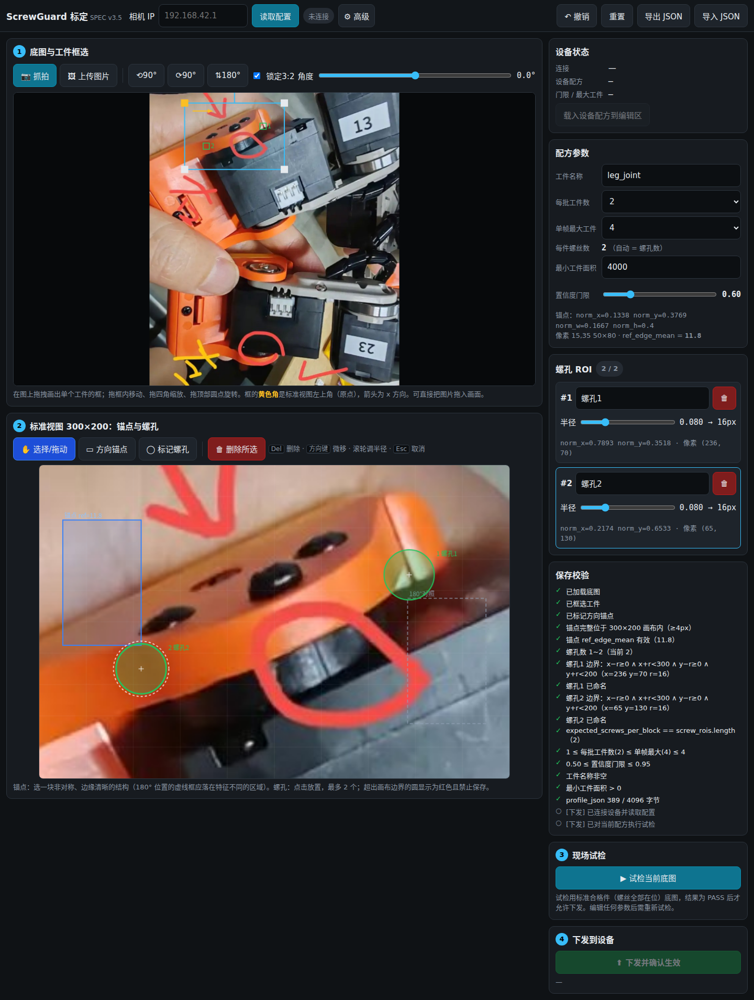
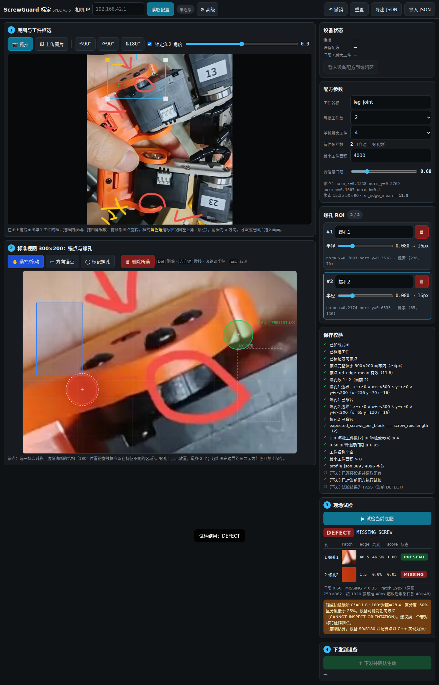
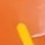
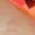
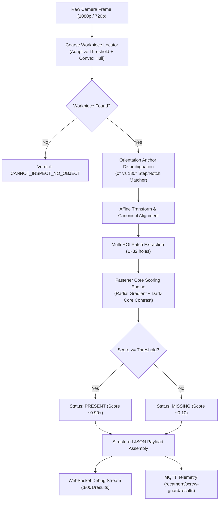

# ScrewGuard

<div align="center">

**Ultra-Fast, Cross-Platform Fastener Inspection & Assembly QA Engine**

[](LICENSE)
[](https://en.cppreference.com/w/cpp/17)
[](https://opencv.org/)
[](#supported-platforms)
[](#benchmarks)
[](#benchmarks)

[English](README.md) | [中文说明](docs/README.zh-CN.md)

</div>

---

ScrewGuard is a high-speed, deterministic optical inspection (AOI) engine designed to detect missing, misaligned, or improperly seated screws and fasteners on precision hardware and robotics assembly lines. 

Unlike heavy deep-learning pipelines that require power-hungry GPUs, ScrewGuard relies on optimized C++17 geometric analysis, 180° orientation disambiguation, and gradient-contrast scoring. It runs in **sub-10ms** on edge devices with an ultra-low memory footprint (**<18MB RSS**).

---

## Visual Showcase

<div align="center">

| 1. Zero-Install Web Calibrator | 2. Live Inspection Verdict |
| :---: | :---: |
|  |  |
| *Visual ROI & Anchor setup in any browser* | *Instant Pass / Defect classification per screw* |

| Screw Present (Clear metallic cross-recess reflection) | Screw Missing (Deep dark-core cavity shadow) |
| :---: | :---: |
|  |  |

</div>

---

## Key Highlights

- **Sub-10ms Deterministic Execution**: Pure C++17 and OpenCV implementation. No GPU or NPU warm-up, zero inference jitter.
- **Zero-Code Browser Calibrator (`web/calib.html`)**: Single-file HTML5 Canvas tool requiring no backend or Python dependencies. Factory operators can import a reference photo, click screw positions, designate orientation anchors, and export production-ready JSON recipes.
- **180° Symmetric Orientation Disambiguation**: Uses asymmetric anchor patches to distinguish between 0° and 180° part placement before ROI extraction.
- **Four-State Mutually Exclusive Arbitration**: Evaluates each fastener against `PRESENT`, `MISSING`, `TILTED`, or `FOREIGN` states with configurable confidence thresholds.
- **Cross-Platform by Design**: Deploys seamlessly from standard Linux workstations and NVIDIA Jetson edge systems to ultra-low-power RISC-V smart cameras.
- **Industrial Connectivity Ready**: Native support for real-time WebSocket debugging streams (port 8001) and MQTT JSON telemetry conforming to Draft-07 JSON Schema.

---

## Supported Platforms

| Platform | Architecture | Typical Latency | Memory (RSS) | Primary Deployment Role |
| :--- | :--- | :--- | :--- | :--- |
| **Linux Workstation / Server** | x86_64 | **< 2 ms** | ~12 MB | High-volume batch offline inspection, CI regression testing |
| **NVIDIA Jetson (Orin / Nano)** | ARM64 (`aarch64`) | **< 3 ms** | ~14 MB | Multi-camera edge gateway, V4L2/GStreamer production lines |
| **Seeed reCamera (SG2002)** | RISC-V 64-bit | **< 8 ms** | ~16 MB | Standalone all-in-one smart camera (Debian package, Supervisor) |
| **Raspberry Pi 4 / 5** | ARM64 (`aarch64`) | **< 6 ms** | ~15 MB | Low-cost modular inspection stations |

---

## Architecture & Detection Pipeline



---

## Quickstart

### 1. Visual Recipe Calibration (Web Browser)
No installation required. Open `web/calib.html` directly in any modern browser:

```bash
# Optional: Launch a lightweight local preview server
python3 -m http.server 8080 --directory web/
# Open: http://localhost:8080/calib.html
```
1. **Upload Reference Specimen**: Select an image of the properly seated assembly (e.g. `web/test_sample.jpg`).
2. **Define Boundary & Anchor**: Click to delineate the workpiece bounding box and define the asymmetric direction anchor.
3. **Mark Screw Holes**: Click each screw location (supports 1 to 32 holes across multiple blocks).
4. **Test & Export**: Click **Trial Run** to verify detections, then **Export Recipe** to download the standard `screw-guard.json`.

---

### 2. Native Build (Linux x86_64 & NVIDIA Jetson ARM64)

Prerequisites: CMake >= 3.16, GCC/Clang with C++17 support, OpenCV >= 4.5.

```bash
# 1. Clone repository
git clone https://github.com/Seeed-Studio/screw-guard.git
cd screw-guard/native

# 2. Build library, test suites, and CLI
mkdir build && cd build
cmake ..
make -j$(nproc)

# 3. Run automated test suite
./test_screw_inspector

# 4. Run CLI on an image
./screw_guard_cli ../../web/test_sample.jpg ../screw-guard.json
```

---

### 3. Seeed reCamera Deployment (RISC-V SG2002)

ScrewGuard compiles out-of-tree using the official Seeed reCamera SDK (`sscma-example-sg200x`):

```bash
# Build standalone Debian package using Docker
export RECAMERA_ROOT=/path/to/sscma-example-sg200x
./build_deb.sh 1.0.0

# Output package: packages/screw-guard_1.0.0_riscv64.deb (3.68 MB)

# Deploy to reCamera over LAN / USB RNDIS
scp packages/screw-guard_1.0.0_riscv64.deb recamera@192.168.42.1:/tmp/
ssh recamera@192.168.42.1 "opkg install /tmp/screw-guard_1.0.0_riscv64.deb"
```

Once installed, ScrewGuard automatically registers into the reCamera Supervisor Console application gallery.

---

## Optical & Lighting Guidelines

Reliable 2D fastener inspection depends on high-contrast separation between the **sunken cavity shadow** and the **metallic screw head specular reflection**:

1. **Light Source Selection**:
   - **Recommended**: **Low-Angle Darkfield Ring Light** or **Dual-Angle Oblique Strip Lights**.
   - **Optical Mechanism**: Low-angle light casts steep shadows inside empty countersunk holes while producing sharp specular glints on the metallic cross/torx head.
   - **Polarization**: In assemblies with glossy plastic housings, mount a linear polarizer on the light source and a cross-oriented polarizer on the camera lens to extinguish plastic surface glare.
2. **Camera Positioning**:
   - Mount the camera strictly normal (90° orthogonal) to the inspection plane at a working distance of 150mm–300mm.
   - Ensure the screw hole diameter resolves to at least **24 pixels** in the camera field of view.

---

## Data Schema & Integration

ScrewGuard outputs structured inspection payloads conforming to Draft-07 JSON Schema:

```json
{
  "schema_version": "2.4",
  "device_id": "station-01",
  "applied_revision": 2,
  "overall_status": "DEFECT",
  "overall_reason": "DEFECT_MISSING_SCREW",
  "summary": {
    "expected_blocks": 2,
    "actual_blocks": 2,
    "passed_blocks": 1,
    "defect_blocks": 1,
    "cannot_inspect_blocks": 0
  },
  "blocks": [
    {
      "block_id": 1,
      "status": "PASS",
      "expected_screws": 2,
      "actual_screws": 2,
      "screws": [
        { "id": 1, "name": "M2_Joint_L", "score": 0.91, "status": "PRESENT" },
        { "id": 2, "name": "M2_Joint_R", "score": 0.92, "status": "PRESENT" }
      ]
    },
    {
      "block_id": 2,
      "status": "DEFECT",
      "expected_screws": 2,
      "actual_screws": 1,
      "screws": [
        { "id": 3, "name": "M2_Leg_Upper", "score": 0.93, "status": "PRESENT" },
        { "id": 4, "name": "M2_Leg_Lower", "score": 0.11, "status": "MISSING" }
      ]
    }
  ]
}
```

---

## Repository Structure

```text
screw-guard/
├── CMakeLists.txt           # Out-of-tree CMake build system (reCamera & multi-platform)
├── LICENSE                  # Apache 2.0 License
├── README.md                # Project documentation
├── SPEC.md                  # Comprehensive system engineering specification
├── build_deb.sh             # Standalone cross-compilation & Debian packager
├── control/                 # Debian package maintenance scripts (postinst, prerm)
├── docs/
│   ├── images/              # Architecture diagrams & demo screenshots
│   └── README.zh-CN.md      # Chinese documentation
├── main/                    # C++17 production daemon for reCamera SG2002
│   ├── app_config.cpp/.h    # Strong-typed JSON recipe parser & bounds checker
│   ├── main.cpp             # Event loop, frame starvation protection & graceful shutdown
│   ├── result_payload.cpp/.h# Real-time WebSocket & MQTT JSON serialiser
│   └── screw_inspector.cpp/.h # Multi-hole scoring & orientation disambiguation engine
├── native/                  # Host C++ test suites & standalone CLI runner
│   ├── CMakeLists.txt       # Native CMake configuration (x86_64 / Jetson)
│   ├── screw_guard_cli.cpp  # Offline CLI inspection tool
│   └── test_screw_inspector.cpp # 8 comprehensive automated unit test suites
├── rootfs/                  # Target filesystem assets (Supervisor manifest, init.d)
└── web/                     # Zero-install Web browser recipe calibrator
    ├── calib.html           # Standalone HTML5 Canvas visual recipe generator
    ├── test_sample.jpg      # Specimen alignment test fixture
    └── validate_schema.py   # Draft-07 JSON Schema validator
```

---

## Roadmap

- [x] Web browser zero-dependency visual recipe editor (`calib.html`)
- [x] Sub-10ms deterministic C++17 inspection engine with 180° disambiguation
- [x] Seeed reCamera SG2002 RISC-V build, Supervisor gallery integration & Debian package
- [ ] **NVIDIA Jetson Native Runner**: Multi-camera V4L2/GStreamer pipeline with zero-copy NVMM buffers
- [ ] **Industrial PLC Integration**: Discrete GPIO trigger & Modbus-TCP synchronization
- [ ] **Auxiliary DL Classifier Plugin**: Optional lightweight ONNX patch-classifier for thread stripping & head defect detection

---

## Contributing & License

Contributions, bug reports, and feature requests are welcome! Please feel free to submit issues or pull requests.

Distributed under the **Apache License, Version 2.0**. See [`LICENSE`](LICENSE) for more information.
