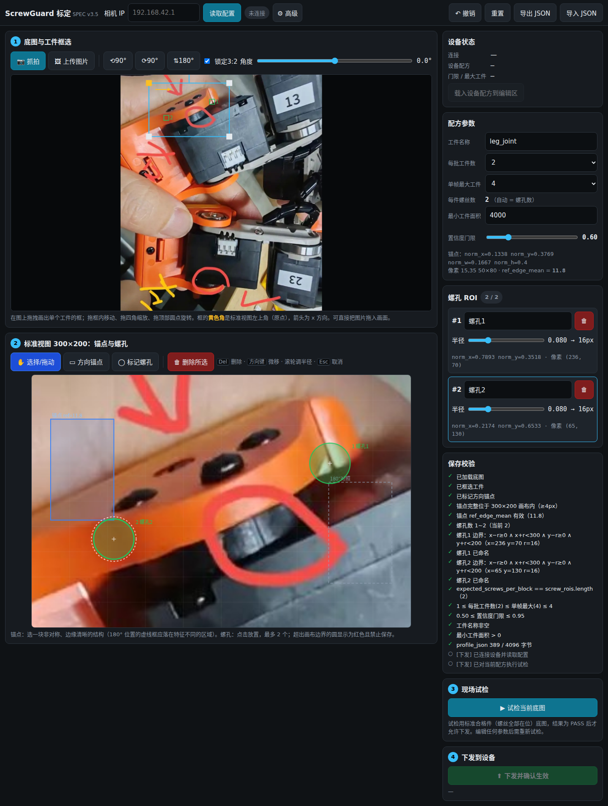
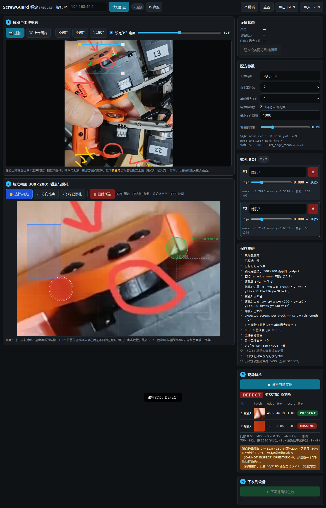
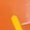
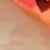

# ScrewGuard (紧固件防漏检与装配质检引擎)

<div align="center">

**跨平台、极速确定性的紧固件/螺丝防漏检与装配质检视觉引擎**

[](../LICENSE)
[](https://en.cppreference.com/w/cpp/17)
[](https://opencv.org/)
[](#支持平台与算力矩阵)
[](#支持平台与算力矩阵)
[](#支持平台与算力矩阵)

[English](../README.md) | [中文说明](README.zh-CN.md)

</div>

---

ScrewGuard 是一套专为精密硬件、电子制造及机器人装配产线打造的高速工业视觉质检系统（AOI）。

不同于依赖重型 GPU/NPU 的深度学习方案，ScrewGuard 采用高度优化的 C++17 几何拓扑定位、180° 朝向消歧与深孔径向梯度对比度评分算法。在边缘设备上实现 **单帧耗时 <10ms**、**内存占用 <18MB RSS** 的超轻量确定性执行。

---

## 视觉成果与工作流

<div align="center">

| 1. 现场工人零安装 Web 标定 | 2. 实时质检结果判定 |
| :---: | :---: |
|  |  |
| *任意浏览器打开，直观框选工件与点击螺孔* | *毫秒级逐孔输出 PASS / DEFECT 状态* |

| 螺钉在位（金属十字槽高光与清晰纹理） | 螺钉缺失（沉孔内深黑阴影与暗核特征） |
| :---: | :---: |
|  |  |

</div>

---

## 核心特性

- **Sub-10ms 确定性高帧率**：纯 C++17 + OpenCV 编写，零模型加载延迟，无推理抖动。
- **免安装浏览器标定工具 (`web/calib.html`)**：单文件 HTML5 Canvas 架构，零后端与 Python 依赖。现场产线工人导入一张基准样件照片，点选螺孔位置、框选方向特征，即可一键导出标准 JSON 配方。
- **180° 对称朝向消歧机制**：通过非对称阶梯/缺口锚点特征，自动消除工件在流水线上 180° 旋转摆放带来的歧义。
- **四态互斥仲裁评分**：针对每个螺孔输出 `PRESENT`（在位）、`MISSING`（缺失）、`TILTED`（倾斜/浮锁）、`FOREIGN`（异物）状态。
- **天然跨平台架构**：从 PC/工控机开发调试，到 NVIDIA Jetson 网关边缘处理，再到 Seeed reCamera 智能相机一体机无缝通用。
- **工业数据总线支持**：内置 WebSocket 实时调试流（8001 端口）与符合 Draft-07 JSON Schema 规范的 MQTT 遥测报文。

---

## 支持平台与算力矩阵

| 运行平台 | 芯片架构 | 质检延迟 | 内存常驻 (RSS) | 推荐部署形态 |
| :--- | :--- | :--- | :--- | :--- |
| **Linux 工控机 / 仿真 PC** | x86_64 | **< 2 ms** | ~12 MB | 离线批量质检、算法迭代与 CI 自动化回归 |
| **NVIDIA Jetson (Orin / Nano)** | ARM64 (`aarch64`) | **< 3 ms** | ~14 MB | 产线多路相机汇聚网关、V4L2/GStreamer 流水线 |
| **Seeed reCamera (SG2002)** | RISC-V 64-bit | **< 8 ms** | ~16 MB | 工业相机一体化即插即用部署（Debian 包，Supervisor 管理） |
| **Raspberry Pi 4 / 5** | ARM64 (`aarch64`) | **< 6 ms** | ~15 MB | 低成本模块化工位质检站 |

---

## 快速上手

### 1. 现场可视化标定配方（浏览器端）
无需安装任何软件或环境，直接在浏览器中打开 `web/calib.html`：

```bash
# 可选：本地启动简单预览
python3 -m http.server 8080 --directory web/
# 浏览器访问：http://localhost:8080/calib.html
```
- **步骤 1（工件框选）**：上传样件底图（或使用示例图 `web/test_sample.jpg`），框选工件整体轮廓；
- **步骤 2（朝向锚点）**：点击「标定方向锚点」，在非对称特征（如台阶、切角）框选锚点；
- **步骤 3（标注螺孔）**：点击「标记螺孔」，依次点击各沉孔中心（支持 1~32 颗孔）；
- **步骤 4（试检与导出）**：点击「实物试检」即时查看置信度评分，点击「导出配方」保存 `screw-guard.json`。

---

### 2. 本地原生编译（Linux x86_64 与 NVIDIA Jetson ARM64）

依赖要求：CMake >= 3.16, GCC/Clang (支持 C++17), OpenCV >= 4.5。

```bash
# 1. 编译核心库、测试套件与 CLI 工具
cd native
mkdir -p build && cd build
cmake ..
make -j$(nproc)

# 2. 运行自动化单元测试套件
./test_screw_inspector

# 3. 运行命令行质检工具
./screw_guard_cli ../../web/test_sample.jpg ../screw-guard.json
```

---

### 3. Seeed reCamera 部署（RISC-V SG2002）

ScrewGuard 支持独立 Out-of-tree 构建，直接利用官方 SDK 生成标准 Debian 安装包：

```bash
# 使用 Docker 执行交叉编译并打包
export RECAMERA_ROOT=/path/to/sscma-example-sg200x
./build_deb.sh 1.0.0

# 产物：packages/screw-guard_1.0.0_riscv64.deb (3.68 MB)

# 通过网络或 USB-RNDIS 推送至设备安装
scp packages/screw-guard_1.0.0_riscv64.deb recamera@192.168.42.1:/tmp/
ssh recamera@192.168.42.1 "opkg install /tmp/screw-guard_1.0.0_riscv64.deb"
```

安装完成后，Supervisor 自动将其加载进 Web Console 应用画廊。

---

## 工业打光与光学准则

紧固件缺陷检测的核心在于建立“沉孔深部阴影”与“螺钉金属反光”的高反差对比：

1. **光源选型**：
   - **强烈推荐**：**低角度暗场环形光（Low-Angle Darkfield Ring Light）** 或 **双向条形倾斜打光**；
   - **光学原理**：低角度照射进入空孔时被孔壁遮挡形成深暗阴影；打在有螺钉的孔内时，金属螺帽凸起十字槽形成极强局部镜面反射；
   - **偏振消除**：工件外壳若为光滑塑料材质，在光源前安装起偏片、镜头前安装正交检偏镜（Cross-polarization），可完全滤除塑料表皮反光。
2. **镜头与架设**：
   - 相机光轴与工件平面必须保持 **90° 正交垂直**，建议工作距离 150mm~300mm；
   - 螺孔在图像中的成像直径建议 $\ge 24\text{ px}$。

---

## 开源协议

本项目采用 **Apache License, Version 2.0** 开源授权，详见 [`LICENSE`](../LICENSE)。
